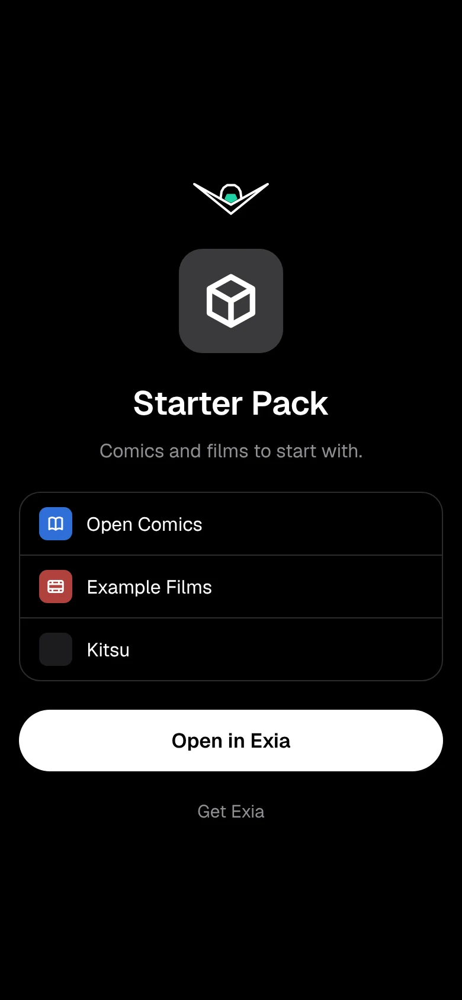
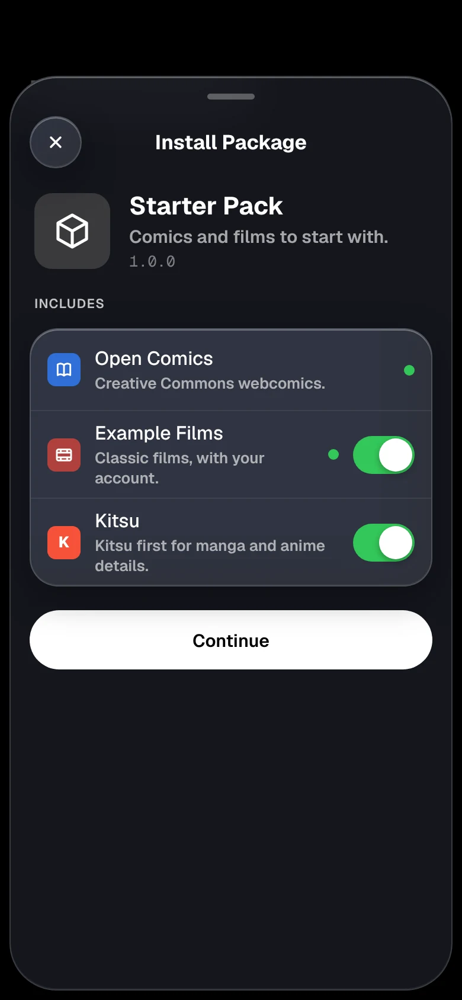
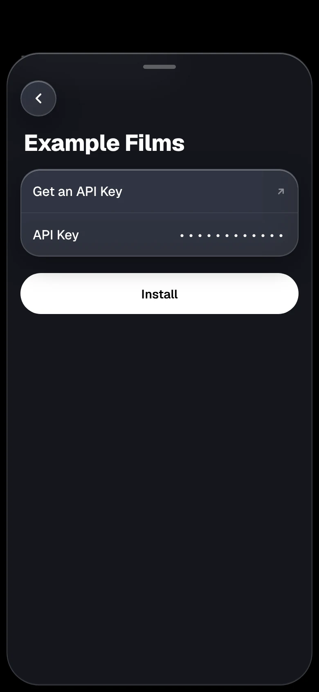

# Exia Package Protocol

An open format for installing things in [Exia](https://projectexia.com) with a setup flow. One `exia.json`
can bundle manga repositories, Stremio addons and metadata settings, and ask the person the few questions
they need (an API key, a quality, a sign-in) on native screens that look like the rest of the app.

A package is data, never code. Exia draws every screen with its own controls, so a package always looks and
works like Exia.

[](badges/)

**Guide:** [Build with the Exia Protocol](https://projectexia.com/guides/build-with-exia-protocol/), step by step with screenshots.

<p>
  
  
  
</p>

## A package

```json
{
  "exia": 1,
  "id": "org.example.starter",
  "name": "Starter Pack",
  "description": "Comics and films to start with.",
  "version": "1.0.0",
  "items": [
    {
      "type": "repository",
      "title": "Open Comics",
      "description": "Creative Commons webcomics.",
      "url": "https://comics.example.org/sources",
      "ids": ["org.example.opencomics.en"]
    },
    {
      "type": "addon",
      "title": "Example Films",
      "description": "Classic films, with your account.",
      "url": "https://films.example.org/manifest.json",
      "config": { "key": "{{filmsKey}}" },
      "fields": [
        { "type": "link", "title": "Get an API Key", "url": "https://films.example.org/keys" },
        { "type": "secret", "id": "filmsKey", "title": "API Key", "required": true }
      ]
    }
  ]
}
```

Exia shows the package with each item's icon, description, reachable status and a switch, then one setup page
per item that has fields, then installs everything at once. If one item fails, nothing is installed.

## What's here

| Path | What |
| ---- | ---- |
| [`SPEC.md`](SPEC.md) | The protocol, version 1 |
| [`schema/`](schema/exia-package.schema.json) | JSON Schema (draft 2020-12) for editors and CI |
| [`src/`](src/index.js) | Reference validator and renderer, no dependencies |
| [`bin/`](bin/exia-package.js) | `exia-package` command line tool ([npm](https://www.npmjs.com/package/exia-package)) |
| [`action.yml`](action.yml) | GitHub Action that checks a package |
| [`CHANGELOG.md`](CHANGELOG.md) | What changed, protocol and tools |
| [`examples/`](examples/) | Valid packages to start from |
| [`tests/`](tests/) | Tests and the conformance vectors every client must match |
| [`badges/`](badges/) | Install in Exia badges (black and white) and the copy-paste snippet |
| [`skill/SKILL.md`](skill/SKILL.md) | An agent skill that teaches coding agents to build packages |
| [`docs/install/`](docs/install/index.html) | The web page behind the badge, which opens Exia |

## Make one

The fastest start is the [template repository](https://github.com/tronschell/exia-package-template): click
**Use this template**, set **Settings › Pages › Source** to **GitHub Actions**, and edit `exia.json`. Every push is
checked and published, and the run summary shows your install link and badge.

Or on your own machine (Node.js 18 or later):

```sh
npx exia-package init                 # write a starter exia.json
npx exia-package serve                # test on your phone: scan the QR code, edit, pull down in Exia to reload
npx exia-package validate             # every problem, with line, column and a fix
npx exia-package render --set apiKey=abc   # the exact URLs Exia installs for those answers
npx exia-package check                # reachable status of every item
npx exia-package link https://you.github.io/pack/exia.json   # install link, badge HTML/Markdown, QR code
```

Point your editor at the schema with `"$schema"` for completion:

```json
{ "$schema": "https://raw.githubusercontent.com/tronschell/exia-protocol/main/schema/exia-package.schema.json" }
```

### In CI

```yaml
- uses: actions/checkout@v4
- uses: tronschell/exia-protocol@v1
  with:
    file: exia.json
```

Problems show up on the lines they're on in the pull request.

## Publishing

1. Host `exia.json` over https. GitHub Pages works.
2. Run `link` with its URL and paste the badge where people will find it.
3. Bump `version` whenever you change the file. Keep `id` the same.

## Coding agents

[`skill/SKILL.md`](skill/SKILL.md) is a skill for Claude Code and other agents that read `SKILL.md` files.
Copy the `skill` folder into your agent's skills directory (for Claude Code, `~/.claude/skills/exia-package/`).

## Contributing

Changes to the protocol start as an issue. Run `npm install && npm test` before opening a pull request. A new
field or item type bumps `exia` to the next version.

## License

MIT
